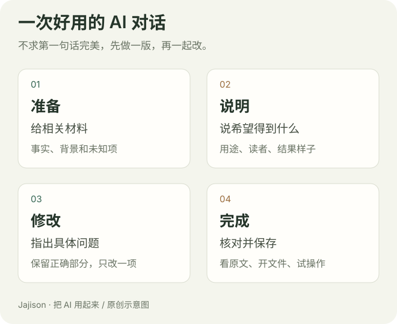

# 和 AI 聊清楚，把第一版改到能用

你给 AI 发“帮我写一个通知”，它回了很长一段，开头是“为进一步丰富大家的精神文化生活”。看起来完整，却没有你要的轻松语气，也没说清楚什么时候报名。

这并不说明你不会用 AI。对方不知道你的读者、不知道哪些安排已确定，自然只能猜一个常见写法。接下来我们把这个过程慢慢走一遍：先说明，再看初稿，再具体修改。

## 从一句普通话开始就好

“提示词”就是发给 AI 的任务说明。你可以像交代同事一样说话，不需要“世界级专家”或一大段角色设定。

试着把“帮我写通知”说得具体一点：

~~~text
请把下面的活动安排写成发给同事的通知。
大家还不了解活动；我希望他们知道时间、地点、要带什么。
正文 120 字左右，语气自然，安排按重要程度写。
没有确定的事项单独提醒我，不补人名和报名链接。
~~~

这里说了四件事：**做什么、给谁看、依据什么、要什么样的结果。** 你不必每次列四个标题，只要这几件事表达清楚就行。

短任务可以很短：“把这段邮件缩成三句话，保留时间和请求，写给熟悉的同事。”复杂一点时才补更多限制。

## 把材料交给它，不让它猜

下载或打开 [虚构活动通知](../downloads/workshop/daily-practice/announcement.txt)。粘贴在要求后，注明“下面是材料”。这份练习里活动开始与报名截止是不同时间，联系人还没确定。

如果你给范文，补一句“只参考语气，新通知的事实以本次材料为准”。否则范文里的名字和日期也可能被带过来。

材料多时，先只给最相关的一小段。难以整理，可以请它先抽取时间、地点、对象和待确认项，你核对后再写正文。资料不明确时，完成一份清楚的待确认清单，本身就有帮助。

## 收到第一版，先看事实

别急着评价“高级不高级”。先对照材料：

- 截止时间和开始时间是否混淆？
- 联系人、地点、参加条件有没有添加？
- 准备事项有没有漏掉？
- 还没确定的内容，有没有被写成确定？

例如初稿写“11 月 7 日 14:00 前报名”，而材料里的报名截止是 11 月 3 日 18:00，你可以这样指出：

~~~text
这里把报名截止和活动开始混淆了。
请对照原文，分别列出两个时间，再修正通知。
其他已经正确的事实保持。
~~~

不要只说“你错了”。把错误位置和原文依据告诉它，更容易得到针对性修正。

## 事实对了，再改成你想要的表达

现在你可能觉得正文太正式。与其说“自然一点”，可以告诉它什么样才算自然：

~~~text
这是同事群里的通知。
去掉宣传口号和重复背景，第一句直接说活动安排。
正文分三行：时间地点、需要准备、报名截止。
不要改已经核对的事实。
~~~

一个示意的修改过程是：

| 初稿里的表达 | 你的反馈 | 希望发生的改变 |
| --- | --- | --- |
| “为进一步丰富……” | 群通知不用背景套话 | 开头直接给安排 |
| 三个日期混在一段 | 截止和活动分开写 | 读者一眼能找到时间 |
| “欢迎积极踊跃……” | 改成普通同事的语气 | 语气简单、没有催促感 |
| “联系小王报名” | 原文没有联系人 | 删除人名，标待确认 |

这类反馈比“再优化十遍”更有方向。你也能看清：哪一句要求改变了哪一处。

## 不知道自己想要什么时，让它先帮你比较

有时你只知道“不对劲”，说不出怎么改。这时不用硬写复杂要求，可以问：

~~~text
先不要重写。给我三个不同方向：
简短直接、温和提醒、稍正式。
每个只写两句，并解释适合什么读者。
~~~

挑一个方向，再继续写整篇。另一种办法是给你喜欢的短句，说明喜欢的是语气还是结构，不要求复制内容。

如果任务缺关键事实，请它先问最影响结果的两三个问题。少量必要澄清比用一页猜测填空更有用。

## 聊了很多轮，怎么避免越改越乱

当你发现它又用旧日期、混进旧要求，先停下来整理“现在确定的版本”。新对话里补齐这张卡，不要只说“按刚才的来”。

~~~text
当前任务：活动通知，给普通同事。
已确认事实：[时间、地点、对象、准备事项]
最终格式：三行正文，100 字左右。
未确认：联系人、报名方式。
请依据这张卡和下方材料重做，不沿用旧版中的猜测。
~~~

“保留正确部分，只改第二段”适合小修改；改了读者、主题或整套材料时，重新整理要求常常更清楚。

## 这一回，你来完成三轮

第一轮用材料写初稿；第二轮纠正一项事实或遗漏；第三轮调整结构与语气。如果事实第一轮就准确，第二轮请它逐项列出依据，自己抽查。

保存初稿、两条反馈和最终版。记录“把活动日期和报名日期分开写”这样可以再用的经验，远比保存一句“请更专业”有用。

接下来把材料换成自己的允许使用内容，重复一次。你会发现，使用上的深入就是能面对不同材料，把同样的过程走稳。

**完成标准**：最终稿事实准确，读者知道下一步做什么；你能指出两条反馈分别改变了哪里。

自测：让 AI 扮演专家，能保证通知里的时间准确吗？

不能。角色可能影响语气和解释角度，时间准确仍依赖材料与核对。缺失的信息要确认，不能靠更专业的口吻补出来。

方法参考：[OpenAI 官方提示组织说明](https://developers.openai.com/api/docs/guides/prompt-engineering/)。本站将相关方法转成日常对话，不要求学习 API。

[继续：写作与修改](writing-and-editing.md) · [资料太多时怎么办](../learn/02-context-and-checks.md)
