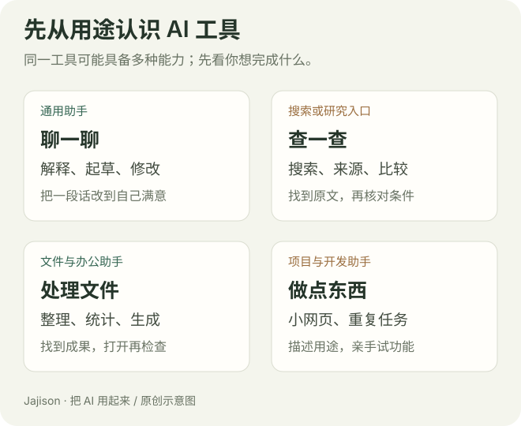

# 带你了解常用 AI 工具

你可能在朋友的手机里见过豆包，听同事说过“让 ChatGPT 帮我写一下”，又在网上看到 Codex 做网页。名字越来越多，很容易产生一种感觉：别人都已经会用了，我是不是得先把这些工具全弄懂？

不用。我们先把它们看作不同的帮手。有的适合陪你讨论，有的帮你找资料，有的可以处理文件，还有的能把一个小工具做出来。你先认识它们，再挑一个帮自己做一件小事，就已经开始了。

这一篇不排“谁最聪明”的名次。下面的用途是试用起点；**具体功能取决于账号、地区、设备和版本，以你的界面和实际结果为准。** 产品入口与帮助说明核对于 2026 年 10 月。

## 先用一分钟认识 AI 助手

你打开一个 AI 工具，通常会看到一个输入框。你可以写“帮我解释这段通知”，也可以给它材料，请它起草、整理、比较或修改。它根据要求生成回应，你再继续补充，像讨论一样来回交流。

但它不知道你没告诉它的事。你让它写请假邮件，却没有说明哪天请假，它可能反过来问，也可能填一个看似合理的日期。后者读起来很顺，却不一定是真的。**流畅表达和事实准确，是两件需要分别检查的事。**

“模型”和“产品”也可以这样分清：模型是里面负责理解与生成的能力，产品是你实际打开的应用，配有输入框、历史记录、文件上传等功能。初学时不用挑模型参数，先看产品能不能完成你的任务。

## 可以直接聊起来的通用助手

### 豆包：从身边的中文小事开始

豆包是可以直接交流的 AI 助手。你可以先试解释陌生词、整理想法、修改一段话；不方便打字时，再看看自己设备里的语音入口。官方介绍说明了聊天、创作与语音功能。[豆包功能介绍](https://www.doubao.com/legal/feature_intro)

比如家人发来一段办事通知，你没看明白，可以问：

~~~text
我第一次办这件事。请把下面的通知解释成普通人能看懂的话。
先告诉我需要准备什么、什么时候做、还有哪些信息没写。
不要替通知补充要求。
[粘贴通知]
~~~

第一次先用文字，你更容易对照原文。语音更方便，但识别后的姓名、日期和数字仍要看一眼。

入口：[豆包官方网站](https://www.doubao.com/)。

### DeepSeek：把一个问题慢慢想清楚

DeepSeek 也提供日常对话入口。可以从解释概念、比较做法、理顺一段逻辑开始，不需要安装开发环境。官方下载页提供移动端入口。[DeepSeek 官方下载](https://www.deepseek.com/zh/download/)

例如你不知道周报该怎么写，可以先讨论结构：

~~~text
我第一次写周报。下面是这周的五条记录。
请先分成“做了什么、有什么结果、遇到什么问题、下周做什么”。
哪条记录缺结果，请直接指出，不要替我编成绩。
[五条记录]
~~~

如果界面有“思考”“搜索”等选项，先看说明。思考较久不代表找到了最新资料；需要当前消息时，要确认实际使用了搜索，并打开来源核对。

入口：[DeepSeek 官方网站](https://www.deepseek.com/)。

### ChatGPT：一边讨论，一边把结果改到能用

ChatGPT 可以用来提问、讨论、起草和修改；文件、搜索及更长任务的工作方式，依实际入口提供。初次从浏览器对话开始，之后再了解桌面工作区，不用一次学完所有模式。[官方使用说明](https://learn.chatgpt.com/docs/use-chatgpt)

拿一个还不明确的想法来回讨论，是很好的起点。比如要向陌生同事介绍一项活动：

~~~text
这是给新同事看的活动介绍。
先写一个 120 字版本，语气自然。
再指出：第一次看到的人，还可能问哪三个问题？
[活动材料]
~~~

看完初稿，指出“这里太正式”“这里没讲清楚谁参加”，请它保留准确的部分再改。这也是本博客最常用的使用过程。

入口：[ChatGPT](https://chatgpt.com/)。账号、套餐和地区要求以官方页面为准。

### Gemini：围绕手上的材料提问

Gemini 是 Google 的 AI 助手。先从普通对话开始；有文件入口时，再试解释文档或表格。官方说明介绍了上传材料与提问的方法，并注明账号和组织设置会影响可用功能。[Gemini 文件说明](https://support.google.com/gemini/answer/14903178?hl=zh-Hans)

比如你手上有一份两页说明书：

~~~text
我上传的是这台设备的说明书。
请告诉我首次使用前要做哪三件事，并标出对应原文位置。
只依据这份文件；看不到或找不到的地方请说出来。
~~~

引用 Google Drive 文件需要另行核对连接和授权。已经登录 Google，并不等于 AI 看到了所有文件。

入口：[Gemini](https://gemini.google.com/)。

### Claude：围绕文章和资料反复打磨

Claude 是 Anthropic 的 AI 助手。可以先试解释材料、调整文章结构、修改语言。它的项目功能允许围绕同一组资料与背景持续工作；可用范围看当前账号。[Claude 项目说明](https://support.claude.com/en/articles/9517075-what-are-projects)

拿一份长总结，先请它找问题，而不是马上整篇重写：

~~~text
先不要改写全文。
请指出这份总结里重复、跳跃和缺少依据的地方。
每项给出原句位置和修改理由，最后让我决定先改哪一段。
[总结]
~~~

这样你保留了对文章的控制，也更容易看出它有没有理解原意。

入口：[Claude](https://claude.ai/)。

### Kimi：从读材料到准备文档

Kimi 是月之暗面的 AI 助手。除对话外，可以按账号入口了解文档、表格、演示等任务功能。官方帮助中心按用途介绍了这些能力；支持某格式不代表每份复杂文件都能完整处理。[Kimi 能力说明](https://www.kimi.com/help/others/capability)

先拿一份会议记录试试：

~~~text
请从这份会议记录提取决定和待办。
每条待办列出任务、负责人、期限和原文依据。
没有负责人或期限时写“未明确”，先不要制作 PPT。
[会议记录]
~~~

先把内容弄准，再生成文件，比一步要求“做一份完美报告”更容易检查。

入口：[Kimi](https://www.kimi.com/)。

> 这些通用助手的能力有很多重叠。上面的场景只是帮助你开始，不能据此断言某款只会写作、某款一定更准确。第一次选一个能正常访问、操作顺手的就好。

## 想查明白一件事时，用搜索助手

Perplexity 把搜索和对话结合起来，回答中提供来源链接，方便继续查证。[Perplexity 官方介绍](https://www.perplexity.ai/help-center/en/articles/10352155-what-is-perplexity)

如果要了解当前政策、产品规格或报名条件，搜索能力比只凭模型已有知识更合适。已有工具若提供搜索，也可以先用，不必另注册账号。

第一次别问“推荐最好的”。可以试：

~~~text
请查这项活动的官方报名通知。
整理报名对象、截止时间和所需材料，给出官方原文链接。
标明通知发布日期；如果是往年通知，请明确说明。
~~~

接着亲手打开链接。AI 可能引用错页面，也可能把不同年份拼在一起。有出处让检查更方便，并没有替你完成检查。

入口：[Perplexity](https://www.perplexity.ai/)。接着读 [查资料与核对事实](research-and-fact-checking.md)。

## 从聊天走到实际文件和小工具

文字任务，复制材料进输入框就能开始。但想整理文件夹、拿到能打开的报告或做小网页时，还要看工具能否访问材料、生成文件和执行操作。

### WorkBuddy：从电脑上的办公材料开始

WorkBuddy 是腾讯的桌面 AI 工作助手。创建任务时可以选择工作目录、提供材料、查看结果文件；官方上手路线介绍了文档、表格、演示和本地文件任务。[WorkBuddy 创建任务说明](https://www.workbuddy.ai/docs/workbuddy/Create-Task)

可以把它想成围绕工作材料协助执行的帮手。例如整理会议记录：给原文，说明清单格式，让它生成新文件，再自己打开核对。

初次只提供独立练习文件夹里的副本，先要求“列出你看到了什么”。找到材料以后，再执行。详见 [WorkBuddy 从零上手](workbuddy-from-zero.md)。

### Codex：把一个明确的小想法做成工具

Codex 可以围绕项目文件开展工作，用自然语言描述需求，协助理解、修改和检查项目。桌面官方说明介绍了选择文件夹与 Codex 的入口。[官方桌面开始说明](https://learn.chatgpt.com/docs/app)

不必先会写代码。先做一个小待办网页：能添加事项、标记完成、导出清单。你负责说清用途、打开实际文件，并亲手试操作。看不懂代码时，请它用普通话说明打开方法和结果。

它也能处理其他知识工作；这里用小网页作为容易体验和核对的入门场景。详见 [Codex 从零上手](codex-from-zero.md)。

你可能还会听到 Cursor、Claude Code 等名字。它们与编辑器、项目或终端结合，开发任务是常见用途。目前只写邮件、看通知，不必先安装；做项目时再读 [工作环境指南](editor-and-environment.md)。

## 还有图片、视频、演示和软件里的 AI

AI 不止是聊天框。常见办公软件、设计工具和图像产品里，也可能有“改写”“生成演示”“生成图片”“转写”等入口。

先从已有软件的官方说明了解一项功能，给一个小样本试用。比如生成一张不含文字的活动背景图，再用熟悉的软件加标题；或者根据已经核对的提纲做三页演示，再检查实际版面。

选工具时问：**我要什么成品？这个入口能交付、下载并继续编辑吗？** 专门工具并不天然更好，普通对话也不天然能交付所有文件。接着读 [图片与语音](images-and-multimodal.md)、[文档与演示](slides-and-documents.md)。

## 现在，完成你的第一次使用

挑一个自己能正常打开的通用助手。从官方入口进入，按提示登录，找到新对话和输入框。这次只需文字输入，不要求上传、付费或连接其他应用。

把下面这段虚构练习发出去：

~~~text
下面是虚构的活动安排，请改成发给同事的简短通知。
活动：周六上午 10 点的读书交流，地点是社区阅览室。
参加者带一本想分享的书，报名在周四晚 8 点截止。
联系人和报名方式尚未确定，请放在通知之后单独提醒我。
通知 100 字左右，自然、清楚，不用夸张宣传语。
~~~

先看日期是否写对：**周四是报名截止，周六是活动开始。** 有没有添加不存在的人名或链接？再补一句：

~~~text
保留已经准确的时间和地点。
改成三行：活动安排、需要准备、报名截止。
语气再轻松一点，未确定事项仍单独列出。
~~~

第二版不会人人相同。一个可核对的写法是：

> 周六上午 10 点，我们在社区阅览室一起聊书。\
> 请带一本想分享的书。\
> 想参加的同事请在周四晚 8 点前报名。\
> 待确认：联系人和报名方式。

复制到自己的笔记里，记下工具和反馈。你已经完成“给材料—出初稿—修改—核对—保存”的完整过程。

## 下一步，选一项你真的会用的任务

| 你最想做的事 | 接着读 |
| --- | --- |
| 还拿不准选哪一个 | [选你的第一款 AI 工具](ai-tool-types.md) |
| 经常写邮件、通知和总结 | [写作与修改](writing-and-editing.md) |
| 查当前信息或比较选择 | [带着出处查资料](research-and-fact-checking.md) |
| 学知识、练语言 | [让 AI 陪你学会](learning-with-ai.md) |
| 整理文件、表格和报告 | [WorkBuddy 上手](workbuddy-from-zero.md) |
| 做自己的小网页 | [Codex 上手](codex-from-zero.md) |

**完成标准**：能用自己的话说出通用对话、搜索和文件执行的区别；完成两轮对话，核对结果并保存。不需要把所有名字背下来。

自测：会聊天的 AI，能自动整理我电脑里的文件吗？

不能仅凭“会聊天”判断。要确认产品具备文件访问与操作入口，材料在可访问范围，并由你提供或授权。第一次用练习目录里的副本，找到实际生成的文件后再核对。

